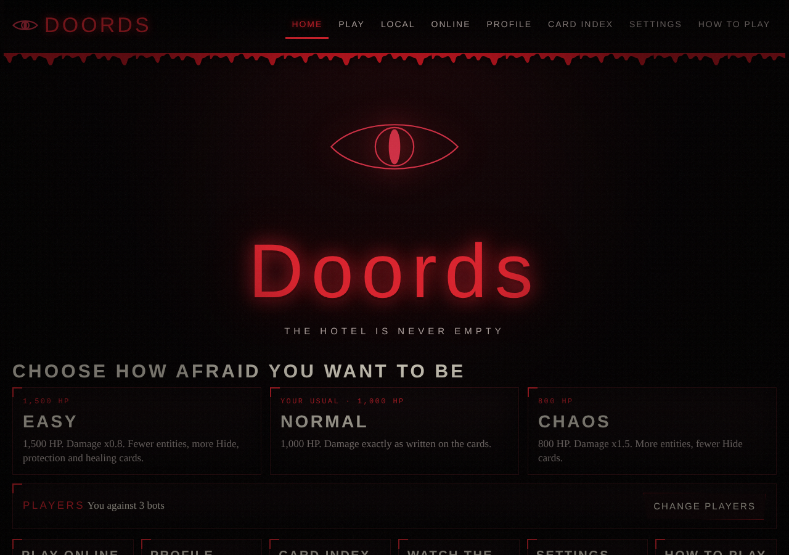
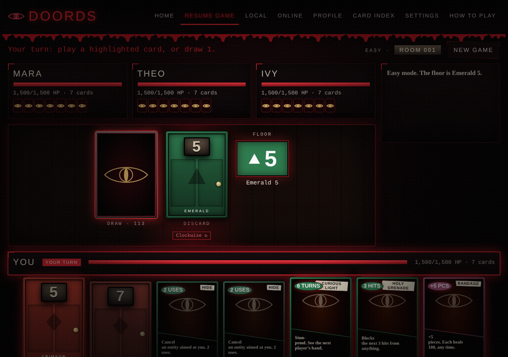
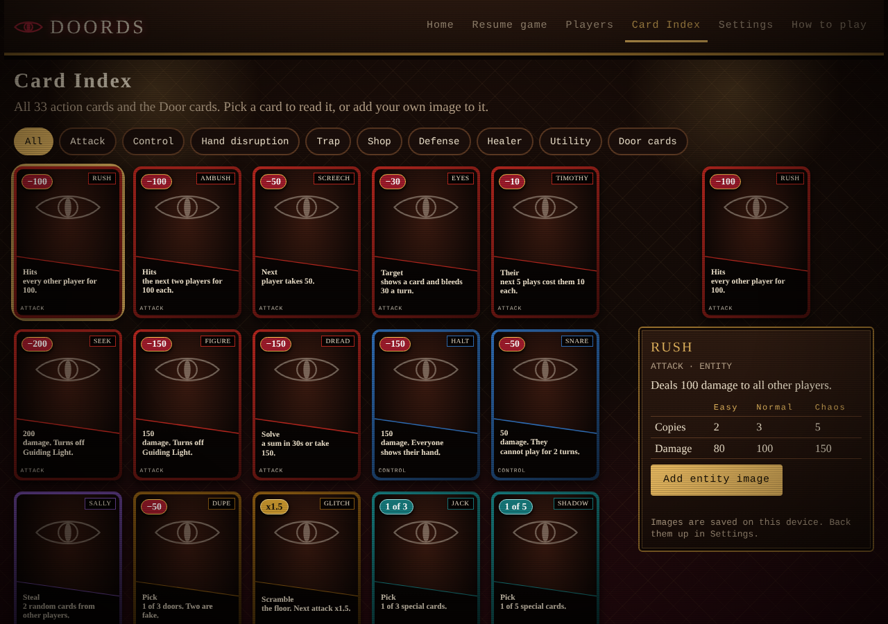
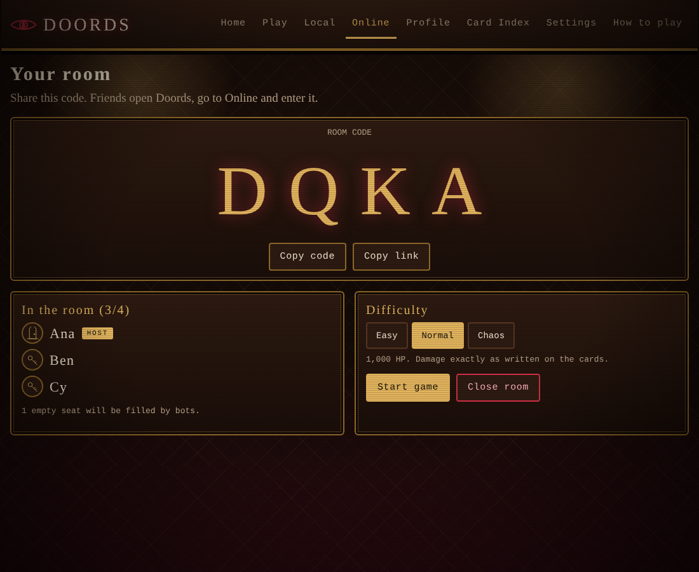

# Doords

A horror card game inspired by the hotel entities of the Roblox game **DOORS**. Play Door cards to clear the room, throw entities at your rivals, and stay alive. Single page, no build step, no dependencies.




## Play

- **Online:** after enabling GitHub Pages (see below) the game lives at `https://<your-user>.github.io/<repo>/`.
- **Locally:** open `index.html` in a browser, or run a static server:

```bash
python3 -m http.server 8000
# then visit http://localhost:8000
```

## Features

- **Online rooms:** make a 4 letter room code, friends join from their own devices (up to 4 players, empty seats become bots).
- **Profiles:** a display name, avatar and win record that follow you into online rooms (stored on your device).
- 1 to 4 players on one device. Seats set to Bot are played by the computer.
- Pass-and-play cover screens hide each hand until its owner is ready.
- Three modes: **Easy** (1,500 HP), **Normal** (1,000 HP), **Chaos** (800 HP, damage x1.5).
- 33 action cards: attack, control, hand disruption, trap, shop, defense, healer and utility.
- Card Index with every card, its numbers per mode and a place for your own entity image.
- Image crop and edit step: drag, zoom, rotate, flip, brightness and contrast, then confirm.
- Changeable logo icon (built-in icons or your own image).
- Settings for game speed, card size, hand order, flicker and scanlines.
- Images, settings and your profile are saved in the browser (IndexedDB and localStorage). Export and import a backup from Settings.



## How to play

1. Everyone starts with 7 cards and full health. Health carries over between rooms.
2. On your turn, play one card or draw one (drawing ends your turn).
3. A Door card must match the floor's wing (colour and shape) or number. Entity, item and healer cards can be played any time on your turn.
4. **Hide** is played when an entity targets you. It cancels the hit and has 2 uses.
5. Play your last playable card to clear the room. Everyone else takes damage for each card left in their hand (up to 8). The last player standing wins.

Protection: Crucifix (5 hits, not Seek or Figure), Holy Grenade (3 hits of anything), Guiding Light and Curious Light (stun-proof), Revive Lotus (revive at half health while held).

## Online play

Online rooms are peer to peer using [PeerJS](https://peerjs.com/) (WebRTC). There is no game server to run.

1. Open **Online**, press **Create room**, and share the 4 letter code (or the **Copy link** URL, which opens the Online page with the code filled in).
2. Friends open the same site, go to **Online**, enter the code and press **Join**.
3. The host picks the difficulty and presses **Start game**. Empty seats are filled by bots.

How it works: the host's browser runs the game and sends each player only what they are allowed to see (their own hand, plus hands revealed by Halt or Curious Light). Players send back their moves. If a player disconnects or stops responding for two turns in a row, a bot takes their seat. If the host closes the tab, the room ends.

Good to know:
- The public PeerJS broker (`0.peerjs.com`) finds players for each other. A few strict networks (some mobile carriers and corporate Wi-Fi) block direct WebRTC connections. If friends cannot connect, try another network.
- To use your own broker or a TURN server, store JSON under the `doords-peer` key in `localStorage`, for example `{"host":"my.server","port":443,"secure":true,"path":"/"}`.
- **Profiles are not passwords.** The profile page keeps your name, avatar and record in this browser only. Real accounts (sign in on any device, a record that follows you, friends) need a backend such as Supabase or Firebase, which can be added later.



## Project layout

```
index.html        page shell
css/style.css     all styling (cards, board, pages)
js/game.js        game engine, bots, views, storage
docs/             screenshots used in this README
.github/workflows/pages.yml   optional GitHub Pages deploy
```

`js/game.js` is a single IIFE. The engine (deck, turns, damage, bots) comes first, then settings and storage, then rendering and input. Card definitions are in the `DEFS` object and difficulty in `MODES`; both are plain data you can edit.

## Deploy to GitHub Pages

1. Push this folder to a GitHub repository (branch `main`).
2. In the repository go to **Settings, Pages** and set the source to **GitHub Actions**.
3. The included workflow publishes the site on every push to `main`.

## Adding entity art

Open **Card Index**, pick a card and press **Add entity image**. Crop it, then confirm. Images stay in your own browser and are not part of this repository.

## Credits and disclaimer

Doords is an unofficial fan project. DOORS and its entities, names and artwork belong to LSPLASH and the DOORS team. This repository contains **no DOORS artwork**; it uses entity names and a game-rule interpretation of their abilities only. If you add the official artwork to your own copy, make sure you have permission to do so, and do not commit it to a public repository without that permission.

Code is released under the MIT License (see `LICENSE`).


## Online and offline mode

Doords runs fully offline (guest or on-device accounts). Add your Supabase Project URL to enable real accounts that sync across devices. See `docs/ACCOUNTS.md`. Only the publishable key is used; never commit a secret or service_role key.
